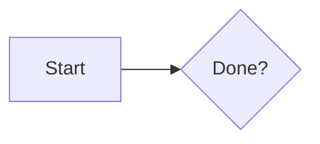

# Lyndsy Simon's Blog

Source for [lyndsysimon.com](https://lyndsysimon.com), built with
[Zensical](https://zensical.org). Content lives in `src/`, posts in
`src/posts/`.

## Writing a post

Add a Markdown file to `src/posts/`. It needs a `date` in the front matter, and
the URL is derived from the post title unless a `slug` is given:

```markdown
---
date: 2026-11-05
categories:
  - Software
tags:
  - python
slug: some_post   # optional; defaults to a slugified title
---

# Post title

The introduction, which is what shows up on the home page listing.

<!-- more -->

Everything after the `<!-- more -->` marker only appears on the post page.
```

The home page, `/archive/`, `/category/`, and `/tags/` are all generated by the
blog and tags plugins — nothing has to be updated by hand.

### Diagrams

A fenced `mermaid` block is rendered to SVG by [Pele](https://pele.run), not
Mermaid.js — Pele is ~270 kB gzipped against Mermaid's ~1.6 MB, has no
dependencies, and themes from the site's CSS variables.

````markdown

````

Pele is vendored at `src/javascripts/pele.global.js` (MIT, licence alongside it)
and loaded lazily, so pages without a diagram never download it. The fence is
emitted as `<pre class="pele">`; do not change that class to `mermaid` or
Zensical's own handler starts fetching Mermaid from unpkg. A diagram Pele cannot
parse falls back to showing its source as a code block.

### Gotchas

* `blog_dir = "."` and `post_url_format = "posts/{slug}"` together are what keep
  post URLs at `/posts/<slug>/`. Zensical looks for posts in `<blog_dir>/posts/`,
  so changing `blog_dir` to `posts` makes it find nothing at all, and dropping
  the prefix from `post_url_format` moves every post to `/<slug>/`. Both break
  published links.
* Posts with a `slug` use it verbatim, which is how the older posts kept their
  underscore URLs from the MkDocs days. New posts without a `slug` get a
  hyphenated URL derived from the title.

## Development

```sh
uv sync
uv run zensical serve -a 127.0.0.1:9124
```

Mission Control runs this as the "Blog" service on port 9124.

## Building

```sh
uv run zensical build
python3 scripts/check_links.py site
```

Pushing to `main` runs the same build in GitHub Actions and deploys to GitHub
Pages.

## TODO

* [ ] Set up [RSS for the blog plugin](https://squidfunk.github.io/mkdocs-material/setup/setting-up-a-blog/#rss)
* [ ] Write a plugin (or contibute support to Pygments) for OpenSCAD
