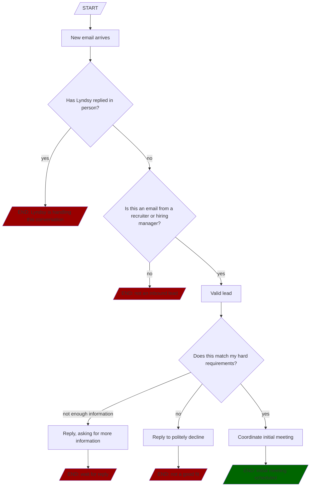

# Job search, week 1: The shotgun approach

I don't have a lot of runway. Without going into the gritty financial details,
my goal is to land a new position by Monday, December 7th - about four weeks
from today. In light of that compressed timeline, my first order of business was
to get as many leads as possible, as quickly as possible.

To make this work, I needed to communicate with a lot of recruiters and hiring
managers _very_ quickly. For that, I turned to my agent, [Henry][].

<!-- more -->

## Lead sources

So far, I have three primary lead sources: LinkedIn, a colleague who offered to
forward my information to his archive of recruiters that have cold-emailed him
in the past, and [Clera][], a job board that I discovered today.

LinkedIn has served me well in the past, but I was saddened to see that they
prohibit automated tools and don't seem to offer an MCP server that I could
find. I considered these higher-quality leads due to the ability to filter
them and choose the best, but they take a great deal of my time to find,
research, and apply.

Clera looks very promising, and doesn't charge for job seekers [which is
important to me][]. It has an MCP server to which I've connected my agent, but I
stopped there at least until I'm able to handle the inbound leads I already
have. When I exhaust those, I expect [Clera][] will be a very effective way to
find more.

Of my existing leads, the colleague's email referrals were most pressing. I have
~150 total referrals hitting my inbox, in batches of 30. That's enough to serve
as my initial lead source, and to let me build my funnel.

## Automating inbound lead handling

This was my first big win.

When a recruiter emails me, Henry handles everything up to scheduling an initial
meeting. He makes it clear that he's an AI, working on my behalf, and uses his
own email address `ai@lyndsysimon.com`. He replies to the recruiter's initial
email, provides any information they request (and asks me directly if he doesn't
yet have it), and arranges the meeting.

Henry doesn't respond unless it's a recruiter, and politely declines to proceed
if my hard requirements aren't met (salary band; no relocation). He also stops
responding immediately if I email the recruiter from my own address - that means
I'm stepping in and taking over the lead.

### Workflow example: recruiter emails

## Next steps

I'll continue letting this run in the background, and add leads by sending them
to Henry as I come across them. Upcoming improvements to my workflow include
properly configuring Clera as a leads source, and establishing a process through
which new leads can be automatically identified. Clera's site alone shows 707
openings that fit my requirements, so I expect that to be sufficient for my
search.

Best of all - by the middle of this week I expect that I'll not need to touch
this process again. It will continue to identify leads, respond or reach out
directly if necessary, and setting up interviews for me. I'll continue
focus on higher-impact tasks.

[Clera]: https://getclera.com
[which is important to me]: https://x.com/lyndsysimon/status/2118409017995477379
[Henry]: /posts/planning-an-ai-assisted-job-search-in-2026/
